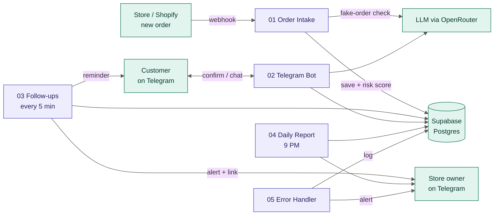

# n8n Automation Portfolio

Production-style automations built with **n8n**, **Supabase (Postgres)**, **Telegram** and **LLMs**: real business problems, real databases, and error handling that holds up when things fail.

## Skills shown

| Area | What's in this repo |
|---|---|
| **n8n** | Webhook, Telegram, Schedule, Manual and Error triggers · Switch / If routing · Loop over items · Code nodes · multi-workflow systems |
| **APIs** | REST over HTTP Request nodes · POST / PATCH · header, query and predefined-credential auth · webhooks · JSON · file downloads |
| **Databases** | Supabase Postgres · PL/pgSQL functions called over REST (`/rpc`) · row level security · idempotent upserts |
| **AI** | LLMs inside workflows (OpenRouter, Google Gemini) · video + audio understanding · structured JSON output with a schema · safe parsing with fallbacks · prompt rules against hallucination |
| **Reliability** | Retries · backup AI models · continue-on-error with fallbacks · duplicate protection · no-double-send follow-ups · rate-limit waits · central error workflow with alerts |

## Projects

### 1. [ShopOps AI](./shopops-ai): fake COD order prevention + AI customer support

Indian online stores lose money on cash-on-delivery orders that get refused at the door. ShopOps AI scores every order for risk, asks risky customers to confirm on Telegram before anything ships, follows up automatically, answers "where is my order?" with an AI bot that reads real order data, and sends the owner a daily report.

**5 workflows · 6 database tables · 9 SQL functions · 28-node Telegram bot with inline buttons · LLM risk check and support**

➡️ [Read the full project](./shopops-ai)

---

### 2. [Meta Ad Analyser](./meta-ad-analyser): which ad creative is working, and why

Meta hides spend and results for ordinary ads, so you can't just sort a brand's ads by "best". This workflow scrapes a brand's live ads from the Meta Ad Library, scores them on the signals Meta does show (impression rank, days running, copies running), has Gemini watch and listen to the top video ads to break down the hook, body and CTA, and ranks them on 60% performance + 40% AI creative score.

**22 nodes · Apify scraper · Gemini video analysis with backup model · Excel sheet + PDF-ready report**

➡️ [Read the full project](./meta-ad-analyser)

---

## Using a workflow

1. Download the `.json` file(s) from the project's folder.
2. In n8n, go to **Workflows → Import from file**.
3. Add your own credentials (each README lists them). No API keys are stored in these files.

_More projects coming soon._

Built by **Pashmeen Kaur**.
