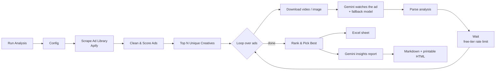

# Meta Ad Analyser

An n8n workflow that finds a brand's live ads in the **Meta (Facebook) Ad Library**, has **Gemini watch and listen to the top video ads**, and ranks them, so a growth team can see which creative is working and why.

One click gives you:

- 📊 **`meta_ad_analysis.xlsx`**: every live ad with its scores and a full hook / body / CTA breakdown
- 📝 **`meta_ad_report.md`** and a printable **`meta_ad_report.html`** (open in Chrome, then Ctrl/Cmd+P and Save as PDF): the winning ad, a ranked table, AI insights, and a page for each ad

## The problem it solves

Meta does not show spend or results for ordinary (non-political) ads, so you cannot just sort a competitor's or your own ads by "best". This workflow scores ads on the signals Meta *does* show, then adds an AI judgement of the creative itself, keeping the two separate.

## How it works

1. **Scrape.** Apify's Facebook Ads Library Scraper pulls the brand's active ads, sorted by impressions, so the first ads are the ones Meta shows most.
2. **Clean and score.** Duplicates and broken text are removed, the caption language is detected, and each ad gets a **performance score out of 100**:
   - 50% impression rank
   - 35% days running (capped at 90)
   - 15% number of copies of the same ad running
3. **Pick unique creatives.** The same video often runs under several ad IDs (A/B copies, caption variants). Only the top *N* **different** creatives go to the AI, so free-tier quota isn't spent twice on one video.
4. **AI watches each ad.** The whole MP4 goes to Gemini, which reads the frames *and* hears the audio. In a talking-head or skit ad the hook is what is *said* in the first 3 seconds, not the thumbnail. It returns a structured JSON breakdown:
   - **Hook:** spoken line, English translation, on-screen text, type, when it ends, why it stops the scroll
   - **Body:** beat-by-beat timeline, key claims, proof
   - **CTA:** offer and urgency
   - **Creative score:** from hook strength, clarity, offer clarity and cultural fit

   The AI is **not told the performance numbers**, so its opinion stays independent.
5. **Rank.** `final score = 60% performance + 40% creative`. Real performance counts more because Meta's delivery algorithm has already "voted" with real money. The weight is a setting.
6. **Report.** A second Gemini call writes the insights (what the winners share, gaps and opportunities). The per-ad breakdown is built straight from the extracted data, not re-written by the LLM, so the report shows exactly what was extracted.

### Built to survive a real run

- If Gemini is busy, it **retries, then switches to a backup model**.
- If one ad still fails, it is marked with `ai_error` and **the run continues**: one bad video can't stop the whole run.
- Videos that are too big fall back to the thumbnail image.
- A wait between calls keeps it inside Gemini's **free tier**.

## Setup

1. In n8n, go to **Workflows → Import from file** and choose [`meta-ad-analyser.json`](./meta-ad-analyser.json).
2. Create two credentials and select them on the HTTP nodes:

   | Node | Credential type | Setting |
   |---|---|---|
   | Scrape Ad Library (Apify) | Query Auth | name `token`, value = your [Apify API token](https://console.apify.com/settings/integrations) |
   | Gemini nodes (4) | Header Auth | name `x-goog-api-key`, value = your [Gemini API key](https://aistudio.google.com/apikey) |

3. Open the **Config** node and set your brand (see below).
4. Click **Execute workflow**. The files appear on the last nodes, ready to download.

## Config

Every setting lives in the **Config** node:

| Field | What it does | Example |
|---|---|---|
| `adLibraryUrl` | An Ad Library search URL (pick the country and keyword in the Ad Library, then copy the URL) | `…ads/library/?country=IN&q="MySivi"…` |
| `brandFilter` | Keeps only ads from pages whose name contains this | `mysivi` |
| `brandName` | Brand name used in the AI prompts and report title | `MySivi` |
| `brandContext` | One or two sentences about the product, offer and audience, given to the AI | `an AI English-speaking tutor app in India…` |
| `resultsLimit` | Ads to scrape | `30` |
| `analyzeTopN` | Unique creatives sent to the AI | `8` |
| `aiModel` / `fallbackModel` / `reportModel` | Gemini models | `gemini-3.6-flash` |
| `maxCreativeMB` | Larger videos fall back to the thumbnail | `14` |
| `waitSeconds` | Pause between AI calls (free-tier rate limit) | `10` |
| `longevityCapDays` | Days running stops counting after this | `90` |
| `performanceWeight` | Share of the final score from performance (the rest is the AI score) | `0.6` |

The included config analyses **MySivi**, the Indian edtech app this workflow was first built for. Change the URL, `brandFilter`, `brandName` and `brandContext` to analyse any brand.

## Tech

n8n · Apify (Facebook Ads Library Scraper) · Google Gemini (video + audio understanding, JSON schema output) · JavaScript Code nodes · Excel / Markdown / HTML export

## Notes

- No API keys are stored in the workflow file; credentials stay in your n8n instance.
- Uses Apify's free monthly credit and Gemini's free tier for a run of about 30 ads / 8 videos.
- Scores are proxies, not real spend or ROAS. Treat the ranking as a strong signal, not ground truth.
