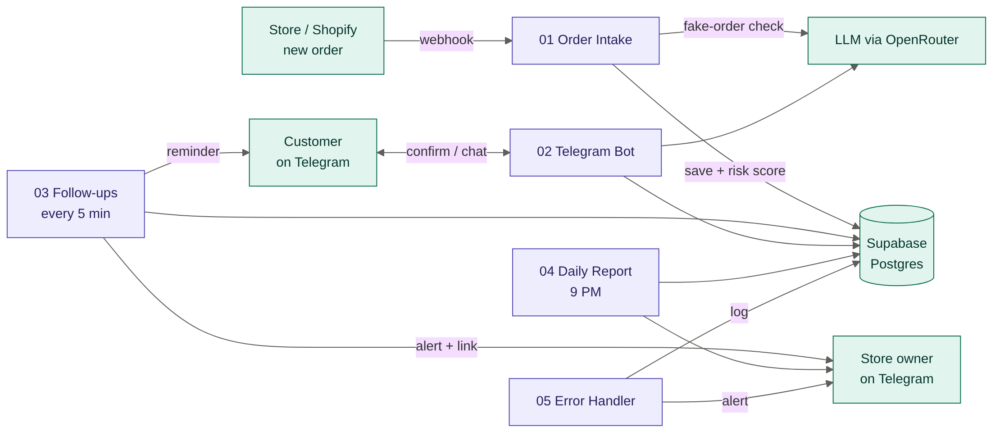
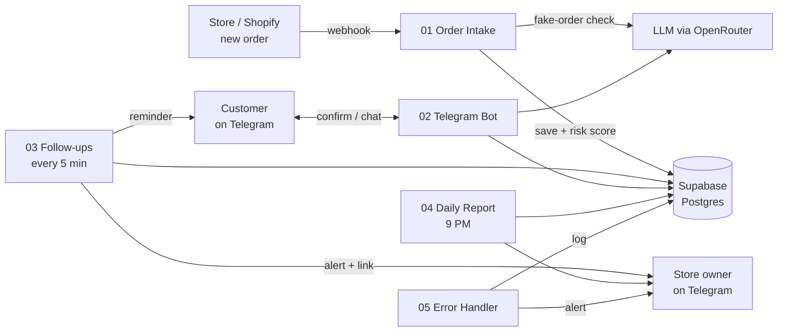
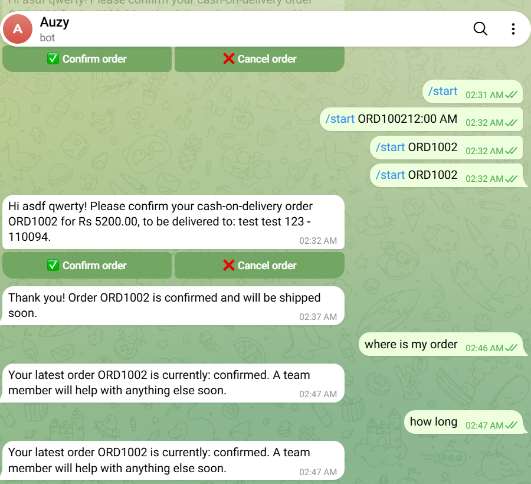
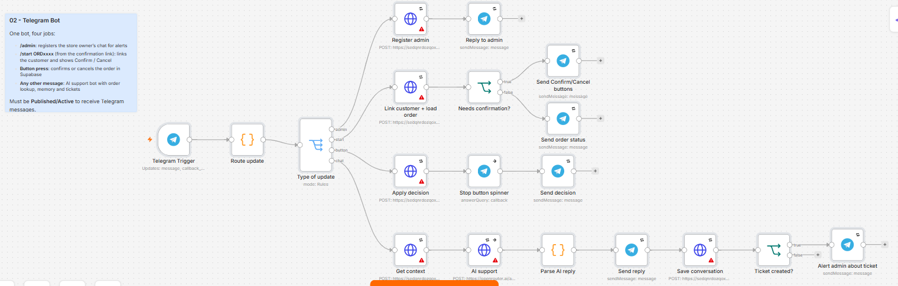
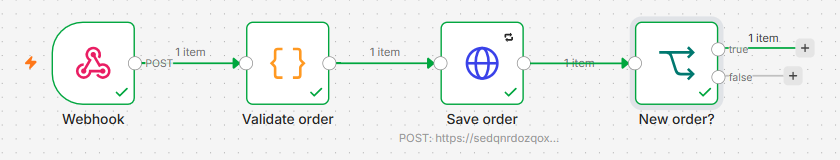
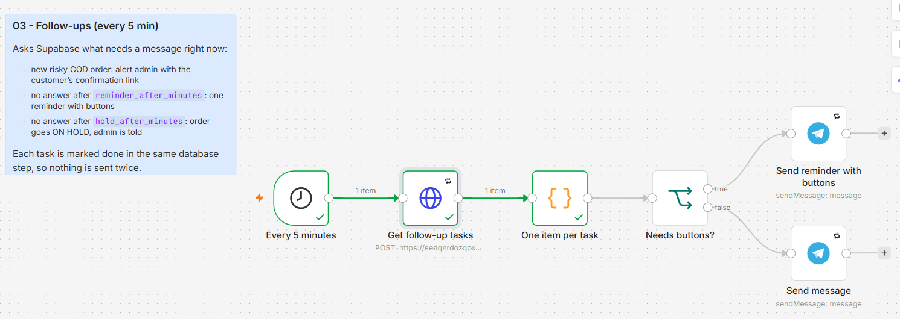

# ShopOps AI

**Automation for Indian online stores that stops fake cash-on-delivery orders and answers "where is my order?" on its own.**

Built with **n8n**, **Supabase (Postgres)**, **Telegram** and **LLMs via OpenRouter**.

> 🎥 **Loom walkthrough:** _add your link here_



---

## The problem

Indian D2C brands lose a lot of money to **RTO (return to origin)**: cash-on-delivery orders that the customer refuses at the door. The store pays shipping both ways and gets nothing. Support teams also spend hours answering the same "where is my order?" messages.

## What ShopOps AI does

1. **Scores every new order for risk** — database rules (new customer, past cancellations, high-RTO pincode, high-value COD) plus an AI check for fake names and addresses.
2. **Asks risky COD customers to confirm** on Telegram with **Confirm / Cancel** buttons before anything ships.
3. **Follows up automatically** — one reminder, then puts unconfirmed orders **on hold** and alerts the store owner.
4. **Answers customers 24/7** — an AI support bot that looks up their real order status, remembers the conversation, and opens a **support ticket** for returns and complaints.
5. **Sends a daily report** to the owner with the day's numbers and an AI-written insight.
6. **Logs every failure** and alerts the owner, so nothing breaks silently.

## Architecture



| Workflow | Trigger | What it does |
|---|---|---|
| **01 – Order Intake** | Webhook (new order) | Validate → save customer + order in one DB call → skip duplicates → AI fake-order check → final risk decision → update order |
| **02 – Telegram Bot (v2)** | Telegram messages + button presses | Customer says hi → shares phone (Telegram-verified) → bot finds their order · confirm/cancel by button **or plain text** · AI support using real orders + store policies · tickets · `/admin` in the owner's group |
| **03 – Follow-ups** | Every 5 minutes | Alerts the owner about new risky orders (with the customer's confirmation link), sends one reminder, puts unconfirmed orders on hold |
| **04 – Daily Report** | Every day at 9 PM | Day's numbers from SQL + 2-line AI insight → owner on Telegram |
| **05 – Error Handler** | Any workflow fails | Logs to `failed_runs` and alerts the owner |

## Reliability by design

- **Order saved before any AI step** — an AI outage can never lose an order.
- **Idempotent writes** — the same order arriving twice (webhook retry) is stored once; pressing Confirm twice changes nothing the second time.
- **No duplicate follow-ups** — each reminder/alert is marked as sent in the same database statement that selects it, so overlapping runs never double-message a customer.
- **Graceful AI fallback** — if the LLM fails or returns junk, risk scoring falls back to rules and the support bot answers straight from the database.
- **Retries** on every external API call.
- **Grounded AI replies** — the support bot only uses order data from the database, and its prompt forbids inventing delivery dates or tracking details.
- **Atomic database functions** — multi-step changes (customer + order, message + ticket) succeed or fail together.
- **Least-privilege security** — row level security on every table and database functions callable only with the server key; the public key can read nothing.
- **Central error handling** — every failure is logged with workflow, node and execution link, and the owner is alerted.

## Tech stack

n8n (self-hosted) · Supabase Postgres (PL/pgSQL functions, RLS, PostgREST) · Telegram Bot API · OpenRouter LLMs · Cloudflare Tunnel

## Screenshots

**Customer confirms the order with one tap, then asks the AI support bot about it**



**02 – Telegram Bot: one trigger, one router, a handler per message type (screenshot from v1)**



**01 – Order Intake: validate → save → duplicate check**



**03 – Follow-ups: runs every 5 minutes, sends reminders and alerts**



## Repository structure

```
shopops-ai/
├── workflows/
│   ├── 01-order-intake.json      ← export from your n8n
│   ├── 02-telegram-bot.json
│   ├── 03-followups.json
│   ├── 04-daily-report.json
│   └── 05-error-handler.json
├── database/
│   ├── 01_schema.sql             ← tables, RLS, create_order()
│   ├── 02_workflows_2_to_5.sql   ← settings + functions for workflows 2–5
│   ├── 03_friendly_messages.sql  ← customer-friendly Telegram message texts
│   └── 04_natural_chat.sql       ← phone linking + store info for the AI (v2)
├── docs/architecture.png
├── docs/screenshots/
└── README.md
```

## Setup

1. **Supabase:** create a project, then run `database/01_schema.sql`, `02_workflows_2_to_5.sql`, `03_friendly_messages.sql` and `04_natural_chat.sql` in the SQL Editor, in that order. Set your bot username:
   ```sql
   update app_settings set value = 'your_bot_username' where key = 'bot_username';
   ```
2. **n8n credentials** (names used by the workflows):
   - `Supabase account` — Supabase API (project URL + secret / service_role key)
   - `Telegram account` — Telegram API (token from @BotFather)
   - `OpenRouter` — Header Auth (`Authorization: Bearer sk-or-...`)
3. **Import** each file in `workflows/` (n8n → Create workflow → ⋯ → Import from file) and pick the credentials in any node that shows a warning.
4. **Error workflow:** in workflows 01–04, open ⋯ → Settings → Error workflow → `05 - Error Handler`.
5. **Publish** workflows 01–05. Workflow 02 needs a public HTTPS URL (n8n's `WEBHOOK_URL`, e.g. via Cloudflare Tunnel).
6. Send `/admin` to your bot once to register yourself as the store owner.

## Demo script

1. Send a normal prepaid order → **confirmed**, low risk.
2. Send a fake-looking COD order (`name: asdf qwerty`, `address: test test 123`, pincode `110094`, Rs 5200) → **pending_confirmation**, high risk with reasons.
3. Within 5 minutes the owner gets an alert with the customer's confirmation link.
4. Open the link as the customer → order summary with **Confirm / Cancel** → press Confirm → order becomes **confirmed** in Supabase.
5. Ask the bot "where is my order?" → it replies with the real status.
6. Tell the bot "I want to return it" → a **ticket** is created and the owner is alerted.
7. Run the daily report → owner receives the summary.
8. Break something on purpose (e.g. a wrong URL) → the error handler logs it and alerts the owner.

## Possible next steps

- WhatsApp Business API instead of Telegram for customers
- Shopify store connected directly (order webhooks + order tags)
- Pincode validation with the India Post API
- A dashboard on top of Supabase for orders, tickets and failures
